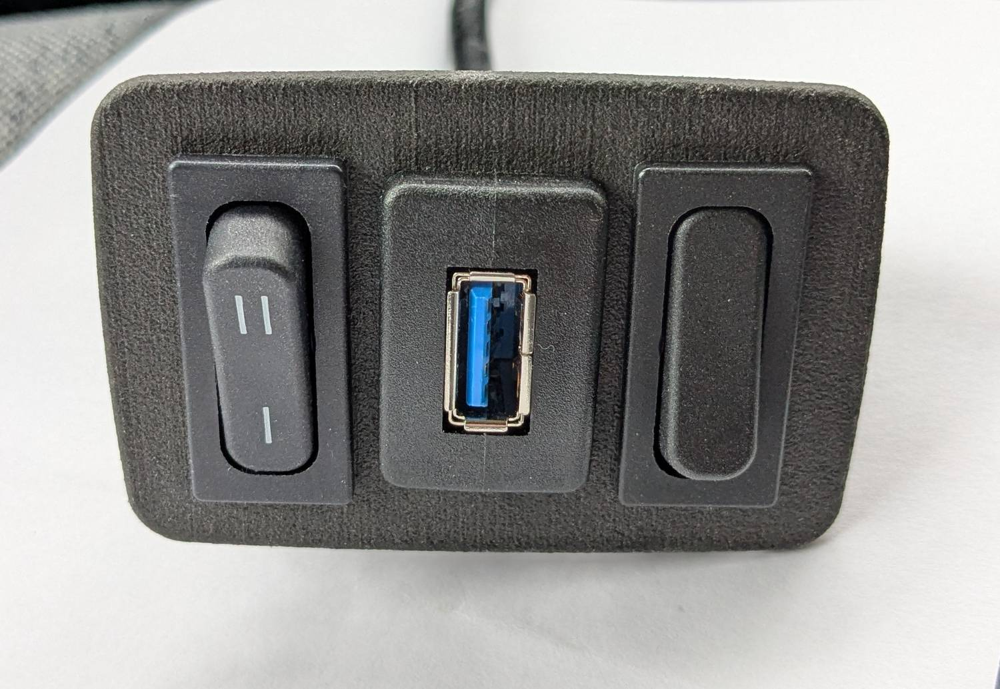
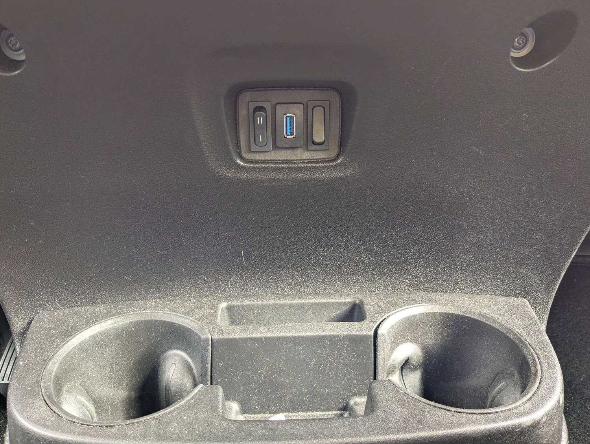
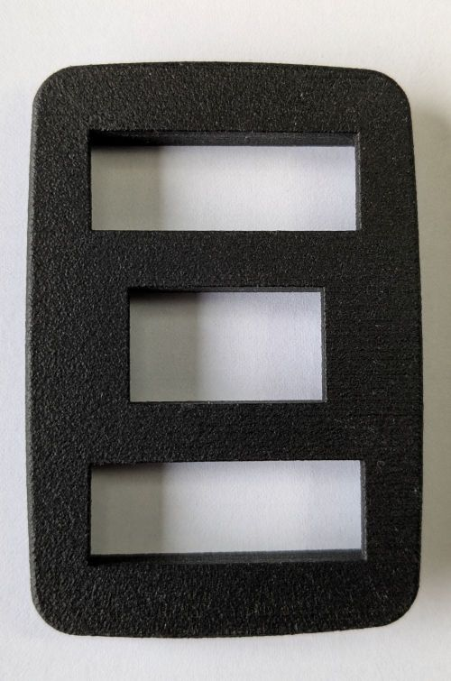
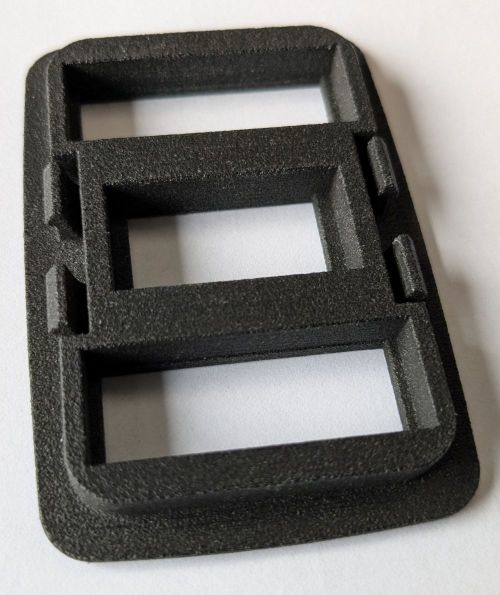

# FreeCAD model of a replacement Panel for the original FIAT Ducato centre Console Cup Holder
This model is meant for a 3D printed panel for the original FIAT cup holder, which replaces the central compartment below the ventilation and heater controls.

The cup holder has a small cut-out with a small 45 x 65 mm² cover. This CAD model allows to create a custom version with 2 switches and an USB socket.

### Mechanical properties
- Size: 65mm x 45mm
- 2mm thick frontpanel
- 5mm thick body 
- 4 locking lugs

### Cut outs
- 2 x Marquardt Series 1830 switch (30.5mm x 11mm)
- USB-A socket (e.g. extension for radio USB) with size 22mm x 13mm
 
### Material for 3D Print
- laser sintered (SLS) Nylon (see images)
- PLA requires much stronger locking lugs

### How to modify?
- the dimensions of teh cutouts are defined in teh spreadsheet `Dimensions`
- three of the locking lugs are copies of `Rastnase1`. So, only modify this version adjust thickness to the used material

### License
The panel design is published under [CERN-OHL-W Version 2](https://cern-ohl.web.cern.ch/)

